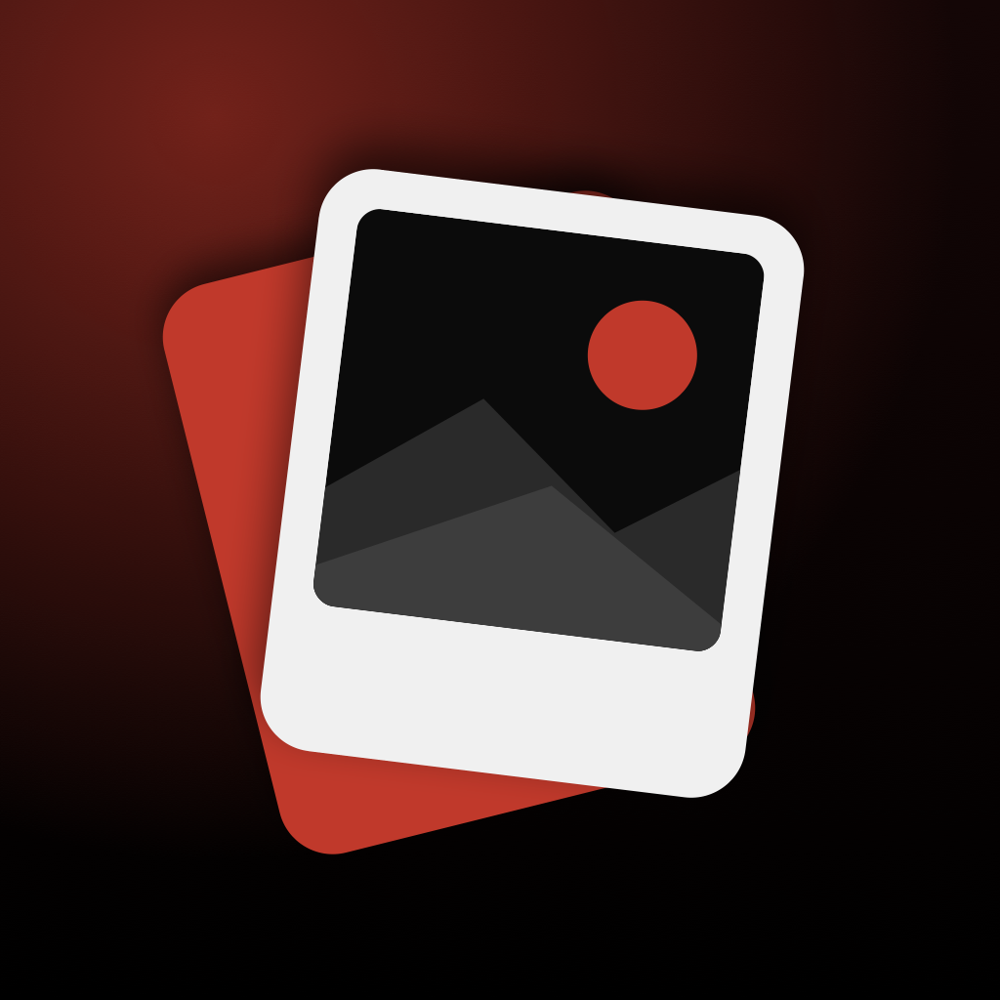
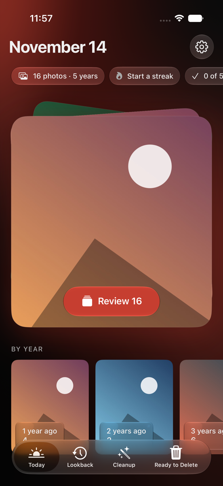
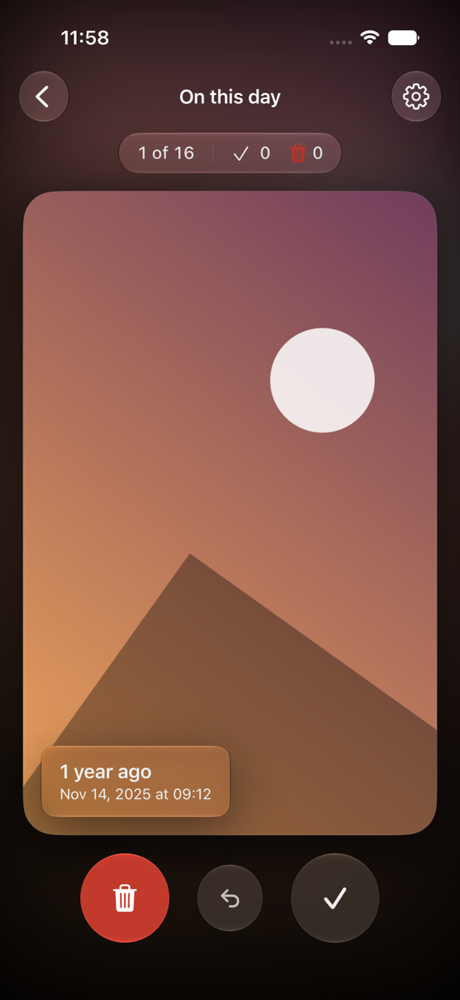
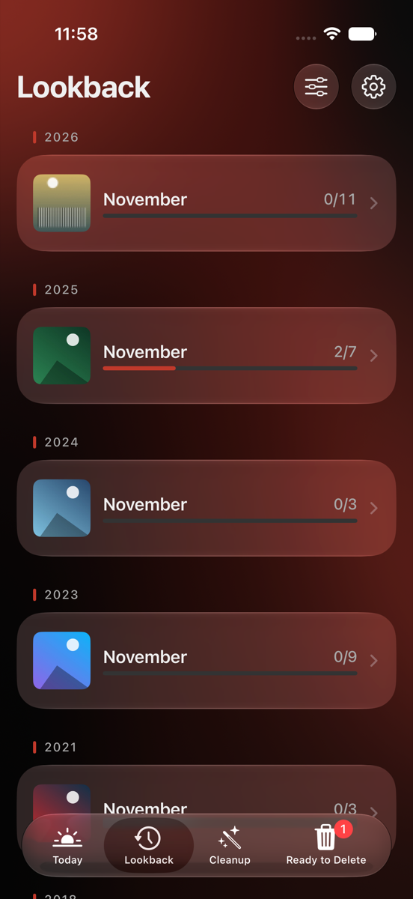
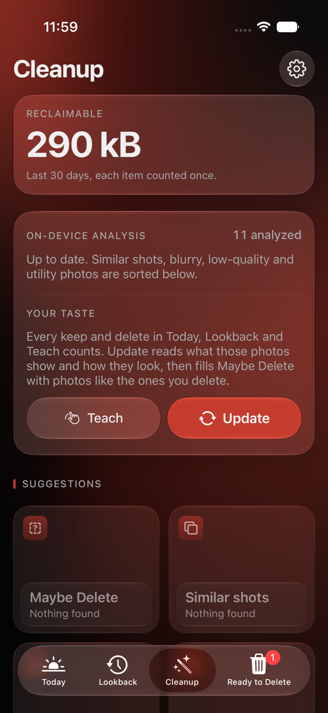
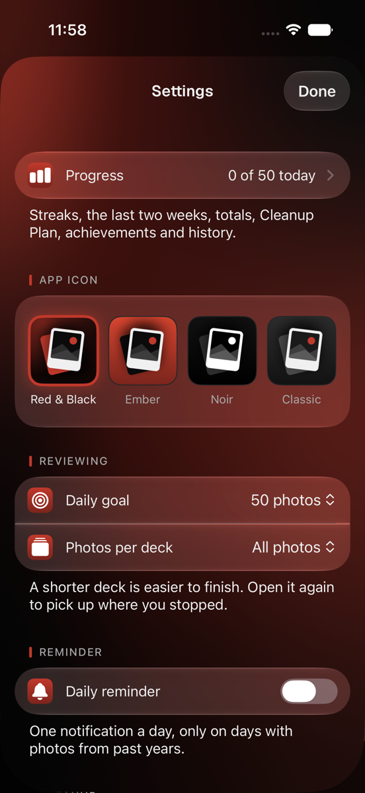

<p align="center">
  
</p>

<h1 align="center">Pictr</h1>

<p align="center">
  <strong>Review your photo library one swipe at a time. Entirely on your iPhone.</strong><br>
  On This Day, a swipe deck, smart cleanup and a model that learns your taste.<br>
  No account. No analytics. No network code.
</p>

<p align="center">
  
  
  
  
</p>

<p align="center">
  
  
  
  
  
</p>

---

## What it does

**Today.** Opens on photos taken on this date in earlier years, grouped by year, with your
streak and today's count against a daily goal.

**The deck.** Swipe right to keep, left to put a photo in Ready to Delete. Undo any swipe.
Tap for a full-screen viewer with zoom, Live Photos, video and details. Favorites are
protected and can never be queued.

**Lookback.** Your whole library grouped by day, week, month or year. Show it as a list,
a photo grid or large cards; sort by date, size or what's left to review; hide what's
finished. Quick Select turns any period into a tap-to-pick grid.

**Cleanup.** On-device analysis, which you start, pause and resume, finds:

| Suggestion | How |
|---|---|
| Similar shots | Vision feature prints, grouped within 10 minutes; the best shot is kept and protected |
| Blurry | Laplacian sharpness checked against Vision's aesthetics score, at three sensitivities |
| Low quality, documents and receipts | Vision aesthetics score and utility flag |
| Screenshots, screen recordings, burst extras, large videos | Photo metadata |
| Maybe Delete | Your own taste model, below |

Compare similar shots side by side with Zoom Lock. Nothing is selected for you, and
nothing is deleted until you confirm.

**It learns what you keep.** Every keep and delete, plus an optional short Teach deck,
trains a small on-device model. It reads what each photo you've decided on shows (Vision's
classifier) and how it looks (feature prints), then suggests photos like the ones you
delete: "Like the receipt photos you delete". Settings shows what it has learned. If you
turn it on, Apple Intelligence's on-device model sums that up in plain English.

**Ready to Delete.** One batch, one Apple confirmation. Photos go to Recently Deleted for
30 days. Space figures are honest: queued, moved to Recently Deleted and iCloud-only are
reported separately, and Pictr never claims space is "freed".

**And:** a daily On This Day reminder that only fires on days with photos, a Progress page
(streaks, a 14-day chart, a Cleanup Plan goal, achievements, history), and four app icons.

## Privacy

Pictr is built so your photos cannot leave the phone:

- **No networking code.** Check: `grep -rnE "URLSession|NWConnection|import Network|URLRequest" Pictr` returns nothing.
- **On-device models only.** Analysis uses Vision. The optional summary uses
  `SystemLanguageModel.default` and never Private Cloud Compute.
- **Local thumbnails.** Analysis and thumbnails never ask iCloud for originals. Only the
  full-screen viewer lets Photos fetch an iCloud original so you can see it.
- **Never deletes on its own.** Every delete goes through Apple's system confirmation.
- **What Pictr stores**, all in its own container: your decisions, classifier tags and
  feature prints for photos you've decided on (no images), and caches.

## Build

Requirements: built with Xcode 27 (iOS 27 SDK) and targets iOS 26 or later. You also need
[XcodeGen](https://github.com/yonaskolb/XcodeGen). The Apple Intelligence summary needs a
device that supports Apple Intelligence; everything else works without it.

```sh
brew install xcodegen
git clone https://github.com/Acker-Cloud/pictr.git && cd pictr
# Set DEVELOPMENT_TEAM in project.yml to your Apple team ID, then:
xcodegen generate
open Pictr.xcodeproj
```

Run the **Pictr** scheme on an iPhone. The simulator works for the interface, but Vision's
models (similar shots, quality, learning) only run on a device.

`project.yml` is the source of truth. Regenerate after changing it rather than editing the
`.xcodeproj` by hand.

## Test

```sh
# Unit tests (simulator)
xcodebuild -project Pictr.xcodeproj -scheme Pictr \
  -destination 'platform=iOS Simulator,name=<simulator>' -only-testing:PictrTests test

# Vision tests (device only; they skip in the simulator)
xcodebuild ... -destination 'platform=iOS,name=<device>' -only-testing:PictrTests/VisionTests test

# Read-only walkthrough on a real device: opens every screen, never keeps or deletes
xcodebuild ... -destination 'platform=iOS,name=<device>' -only-testing:PictrUITests/DeviceSmokeTests test
```

`PictrUITests/ScreenTourTests` drives the simulator and saves screenshots to
`TEST_RUNNER_SCREENSHOT_DIR`. Seed it with dated sample photos first:
`swift Tools/make-seed-photos.swift <dir>`, then `xcrun simctl addmedia booted <dir>/*.jpg`.

## Architecture

```
Pictr/
  App/           Entry point, tab root, environment
  Library/       The only code that imports Photos: PhotoLibraryClient protocol + PhotoKitClient
  Analysis/      Buckets, sizing, Vision analysis, LibraryScanner actor
  Learning/      Taste model, subject and look-alike signals, trait store, Apple Intelligence
  Decisions/     DecisionBook (keeps, queue, streaks, plan), persisted as JSON
  Review/        Swipe deck, review session, media views
  Features/      Today, Lookback, Cleanup, Ready to Delete, Settings, Progress, Viewer
  DesignSystem/  Tokens, mesh background, glass panels, page header, logo
Tools/           App icon renderer, sample photo generator
```

- Pure logic (bucketing, grouping, learning, progress) runs over plain value types and is
  unit tested with fakes. PhotoKit sits behind one protocol.
- Swift 6 language mode with strict concurrency, and warnings are errors. There are no
  third-party dependencies.
- Design: red-and-black Liquid Glass over a slowly drifting mesh, with Geist and DM Sans.
  Red is used for graphics only, never for text, so every label meets WCAG AA contrast.

## Contributing

Issues and pull requests are welcome. Please keep the privacy guarantees intact (no
networking, no analytics, no automatic deletes). Run the unit tests and a zero-warning device
build before opening a PR. `CLAUDE.md` holds the project conventions and the mistakes that
have already been made once.

## License

[MIT](LICENSE). Geist and DM Sans are bundled under the SIL Open Font License 1.1.
